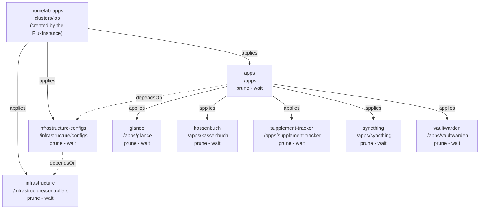

# homelab-apps

What runs on the cluster, reconciled by Flux. The layer below
[platform](https://github.com/Sojamann/homelab) which installs Flux and
then stops.

## Layout

```
clusters/lab/              the entrypoint -- FluxInstance.spec.sync.path points here
infrastructure/controllers shared services -- operators and charts the apps depend on
infrastructure/configs     CRs naming kinds the controllers install -- rules, scrapes, backups of controllers
apps/                      a Flux Kustomization per app, plus its directory
```

diagram:

> post-build applies `cluster-vars` secret providing the domain

## Infrastructure
Shared services the apps depend on being installed, operators and the like.
Two Kustomizations, because a CR cannot be applied in the same pass as the
chart that defines its kind:

- `infrastructure` -> `controllers/`: the charts. Nothing here may name a CRD
  another chart in this tier installs. The name predates the split and must
  not change -- renaming prunes the CNPG release, its CRDs, and every database.
- `infrastructure-configs` -> `configs/`: CRs no app owns (scrape targets
  outside the cluster, rules, dashboards). A CR an app owns belongs beside that
  app instead -- unless the app is itself in `controllers/`, like Pocket ID's
  backup in `configs/pocket-id/`.

| Name                  | Description       | Namespace        | Version                        | Docs                         |
|-----------------------|-------------------|------------------|--------------------------------|------------------------------|
| cloudnative-pg        | postgres operator | `cnpg-system`    | chart 0.29.0 (operator 1.30)   |                              |
| kube-prometheus-stack | metrics + grafana | `monitoring`     | chart 91.3.0 (operator 0.94.0) | [link](./docs/monitoring.md) |
| pocket-id             | OIDC provider     | `pocket-id`      | v2.18.0                        | [link](./docs/pocket-id.md)  |
| volsync               | PVC backups       | `volsync-system` | chart 0.16.0                   | [link](./docs/volsync.md)    |
| zot                   | OCI registry      | `zot`            | v2.1.22                        | [link](./docs/zot.md)        |

Grafana is served at `grafana.${app_domain}`, Alertmanager at
`alertmanager.${app_domain}`, the registry at `registry.${app_domain}`, Pocket
ID at `login.${app_domain}`.

## Updates
Renovate (`renovate.json`) opens a PR when a chart version (`OCIRepository`
tag or `HelmRelease` on a `HelmRepository`) or a
public image has a new release that is 3 days old. Merging is deploying --
Flux reconciles `main`.
Images in our own zot registry are skipped; `mise run image` bumps those.

## Apps
Every app is its own flux `Kustomization` so it is reconsiled seperately and
is deployed in it's own namespace which may hold the app itself together
with secrets and storage definitions.

| Name               | Description                    | Domain                      | Docs                                 |
|--------------------|--------------------------------|-----------------------------|--------------------------------------|
| glance             | Lab start page, release feed   | `dash.${app_domain}`        | [link](./docs/glance.md)             |
| kassenbuch         | Kassenbuch of the Verein       | `kassenbuch.${app_domain}`  | [link](./docs/kassenbuch.md)         |
| supplement-tracker | Household supplement tracker   | `supplements.${app_domain}` | [link](./docs/supplement-tracker.md) |
| syncthing          | File sync hub, self-hosted cloud | `sync.${app_domain}`      | [link](./docs/syncthing.md)          |
| vaultwarden        | Household password manager     | `passwords.${app_domain}`   | [link](./docs/vaultwarden.md)        |


- **`enableServiceLinks: false`, always.** The kubelet injects a Docker-link
  variable per Service in the namespace -- `{SERVICE_NAME}_PORT=tcp://ip:port`
  and friends. Which might lead to unwanted configurations.

## Moving a PVC between storage classes
`storageClassName` is immutable, so the data is copied into a new PVC with the
app scaled to 0 and Flux suspended. Then two pushes: first switch to the new
PVC while keeping the old one in git with `kustomize.toolkit.fluxcd.io/prune:
disabled`, then drop it from git and delete it by hand. Set with `kubectl
annotate` instead, Flux strips the annotation and prunes the PVC and its data.
