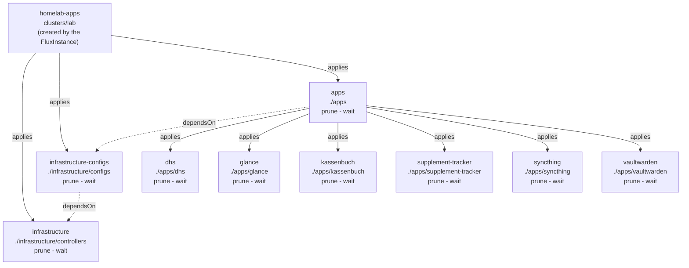

# homelab-apps

What runs on the cluster, reconciled by Flux. The layer below
[platform](https://github.com/Sojamann/homelab) which installs Flux and
then stops.

## Layout

```
clusters/lab/              the entrypoint -- FluxInstance.spec.sync.path points here
infrastructure/controllers shared services -- operators and charts the apps depend on
infrastructure/configs     CRs naming kinds the controllers install -- rules, scrapes, backups of controllers
apps/                      a Flux Kustomization per app, plus its directory
```

diagram:

> every Kustomization substitutes from the `cluster-vars` Secret (domains, tailnet suffix, Telegram chat id), written by the platform layer

## Infrastructure
Shared services the apps depend on being installed, operators and the like.
Two Kustomizations, because a CR cannot be applied in the same pass as the
chart that defines its kind:

- `infrastructure` -> `controllers/`: the charts. Nothing here may name a CRD
  another chart in this tier installs. The name predates the split and must
  not change -- renaming prunes the CNPG release, its CRDs, and every database.
- `infrastructure-configs` -> `configs/`: CRs no app owns (scrape targets
  outside the cluster, rules, dashboards). A CR an app owns belongs beside that
  app instead -- unless the app is itself in `controllers/`, like Pocket ID's
  backup in `configs/pocket-id/`.

| Name                  | Description       | Namespace        | Docs                         |
|-----------------------|-------------------|------------------|------------------------------|
| cloudnative-pg        | postgres operator | `cnpg-system`    | [topic](../docs/src/platform/cloudnative-pg.md) |
| kube-prometheus-stack | metrics + grafana | `monitoring`     | [link](./docs/monitoring.md) |
| pocket-id             | OIDC provider     | `pocket-id`      | [link](./docs/pocket-id.md)  |
| tailscale             | tailnet egress    | `tailscale`      | [link](./docs/tailscale.md)  |
| volsync               | PVC backups       | `volsync-system` | [link](./docs/volsync.md)    |
| zot                   | OCI registry      | `zot`            | [link](./docs/zot.md)        |

Versions live in the manifests only (`repository.yaml` / `release.yaml` /
`server.yaml` per directory), so a Renovate bump cannot leave a stale copy.

Grafana is served at `grafana.<app_domain>`, Alertmanager at
`alertmanager.<app_domain>`, the registry at `registry.<app_domain>`, Pocket
ID at `login.<app_domain>`.

## Updates
Renovate (`renovate.json`) bumps chart versions and public images; merging is
deploying. Policy: [Maintenance](../docs/src/maintenance.md#renovate).

## Apps
Every app is its own Flux `Kustomization`, so it reconciles separately, and
lives in its own namespace together with its secrets and storage.

| Name               | Description                    | Domain                      | Docs                                 |
|--------------------|--------------------------------|-----------------------------|--------------------------------------|
| dhs                | Backups + scrape of the DHS box, over the tailnet | --                 | [link](./docs/dhs.md)                |
| glance             | Lab start page, release feed   | `dash.<app_domain>`         | [link](./docs/glance.md)             |
| kassenbuch         | Kassenbuch of the Verein       | `kassenbuch.<app_domain>`   | [link](./docs/kassenbuch.md)         |
| supplement-tracker | Household supplement tracker   | `supplements.<app_domain>`  | [link](./docs/supplement-tracker.md) |
| syncthing          | File sync hub, self-hosted cloud | `sync.<app_domain>`       | [link](./docs/syncthing.md)          |
| vaultwarden        | Household password manager     | `passwords.<app_domain>`    | [link](./docs/vaultwarden.md)        |

App pages: [Workloads](../docs/src/workloads/index.md).

- **`enableServiceLinks: false`, always.** The kubelet injects a Docker-link
  variable per Service in the namespace -- `{SERVICE_NAME}_PORT=tcp://ip:port`
  and friends. Which might lead to unwanted configurations.
