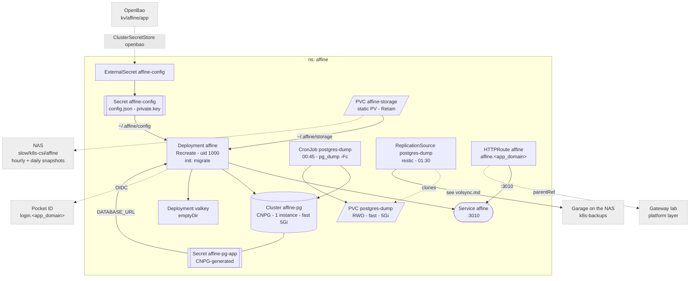

# AFFiNE

Docs and whiteboards, on trial against Memos. One Deployment behind the
Gateway, its own CNPG postgres and Valkey, SSO through Pocket ID, the config
file rendered from OpenBao.

Why it looks like this:

- **The first CNPG `Cluster`.** AFFiNE needs postgres with pgvector, which
  CNPG's `standard` image ships. The migrations create `vector` and
  `pgcrypto` only if they can, and the app role cannot -- so
  `postInitApplicationSQL` does, as superuser, at bootstrap.
- **Backed up by a dump, as DHS** ([dhs.md](./dhs.md)): `dump.yaml` writes
  `pg_dump -Fc` to `postgres-dump`, which has the `backup.yaml` -- see
  [volsync](./volsync.md). The `Cluster`'s own PVC is not backed up: a dump
  restores into any postgres of the same major or newer, a raw data dir does
  not. `rules.yaml` alerts on a stale dump.
- **The config dir is a Secret.** `config.json` holds git's settings and the
  Pocket ID client; `private.key` is the key AFFiNE signs and encrypts with.
  Upstream's migration step writes that key if missing -- generated in tofu
  instead, as it would otherwise change on every pod.
- **Blobs on the NAS**, as memos' attachments: a static `Retain` PV on
  `/mnt/slow/k8s-csi/affine`, made by hand -- see
  [machines/truenas.md](../../machines/truenas.md).
- **Valkey without persistence.** Sessions, queue, cache.
- **Runs as uid 1000** (the image's `node`), read-only root filesystem; the
  server writes its GraphQL schema to `/app/src` at start, an `emptyDir`.
- **Migrations in an initContainer** (`self-host-predeploy.js`), upstream's
  compose `affine_migration` service. `Recreate`, so two never race.
- **No metrics.** `/info` is the probe.

Pocket ID client, users, restore: [AFFiNE](../../docs/src/workloads/affine.md).
