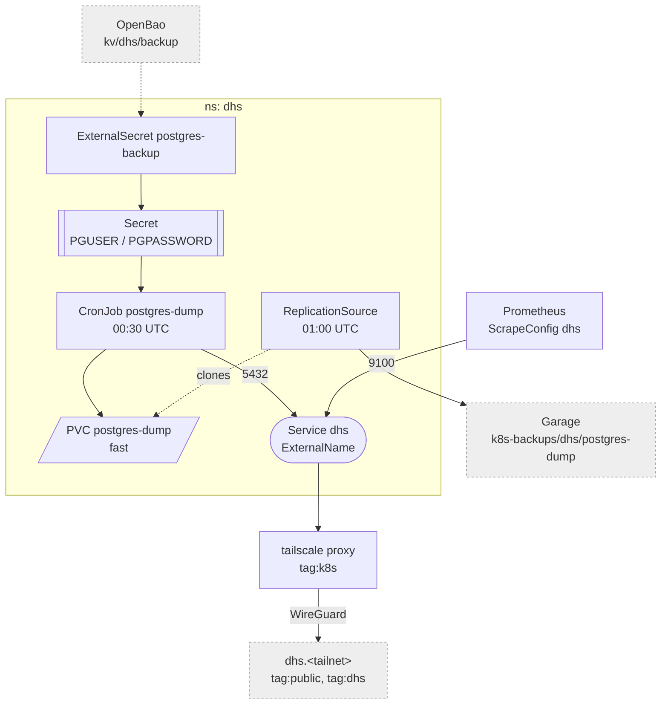

# DHS

The DHS app runs on a public Hetzner box, not in the cluster: Ubuntu, docker
compose, postgres. The box opens nothing toward the lab, so the cluster pulls
from it over the tailnet -- a nightly `pg_dump` into a `fast` PVC that VolSync
backs up, and a scrape of its node_exporter. Both go through one tailscale
egress proxy -- see [tailscale](./tailscale.md).

Why it looks like this:

- **The dump is written aside** (`postgres.dump.tmp`, `sync`, `mv`): the
  ReplicationSource clones the PVC at `01:00`, and a clone must never catch a
  half-written file. `-Fc`, the latest one only; its history is restic's --
  see [volsync](./volsync.md).
- **Mover and dump run as uid 70**, postgres in the alpine image.
- **`dump.yaml`'s image tracks the server's major (17):** an older `pg_dump`
  refuses the server, a newer one writes dumps the server's own `pg_restore`
  cannot read. Bump both together.
- **`egress.yaml` names both ports**, but the proxy forwards every port; the
  tailnet policy is what limits `tag:k8s` to 5432 and 9100.
- **`scrape.yaml` relabels `instance` to `dhs`** -- the target address is only
  the proxy Service's name. It sits in `monitoring`, beside Prometheus, and
  `rules.yaml` carries `DhsDown` / `DhsDumpStale`.

The box's setup, the backup role, alerts and the restore:
[DHS](../../docs/src/workloads/dhs.md).
