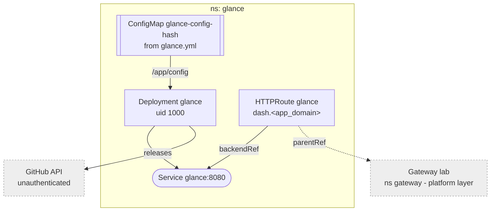

# Glance

Lab start page, upstream `glanceapp/glance`. No state, no secrets, no
storage.

`apps/glance/glance.yml` goes through a `configMapGenerator`, so the
ConfigMap's name carries a content hash and an edit rolls the pod. Config,
release tracking, substitution gotchas and updates:
[Glance](../../docs/src/workloads/glance.md).
