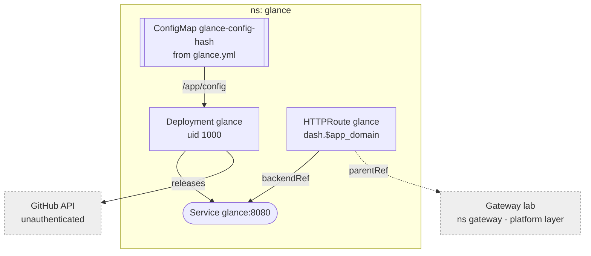

# Glance

Lab start page, upstream `glanceapp/glance` pinned by tag: bookmarks plus
upstream release tracking. No state, no login: LAN and tailnet only, like
everything behind the gateway.

## Config

`apps/glance/glance.yml` is the whole page. A `configMapGenerator` turns it
into a ConfigMap whose name carries a content hash, so an edit rolls the pod.
Flux substitutes `${app_domain}` and `${lab_domain}` into it like any other
manifest -- a literal dollar sign must be written `$$`. That also means
Glance's own `${ENV}` syntax is unusable without escaping.

Logos load in the browser from the `homarr-labs/dashboard-icons` jsDelivr CDN,
pinned to a commit since that repo has no tags. Own apps use `mdi:` icons.

## Release tracking

Fetched server-side, so the pod needs egress to the internet.

- `releases`: every version the cluster and platform layers pin. Unauthenticated
  GitHub allows 60 requests/hour, plenty for a dozen repos. Past ~20, add a
  token via an `ExternalSecret`.
- Proxmox and TrueNAS publish no GitHub releases, so they are not tracked;
  their forum announcement feeds were too noisy to be worth a widget.

Compare against the version locals in `cluster/` and `platform/` in the
parent repo when bumping.

## Updates

Bump the tag in `apps/glance/server.yaml`.
