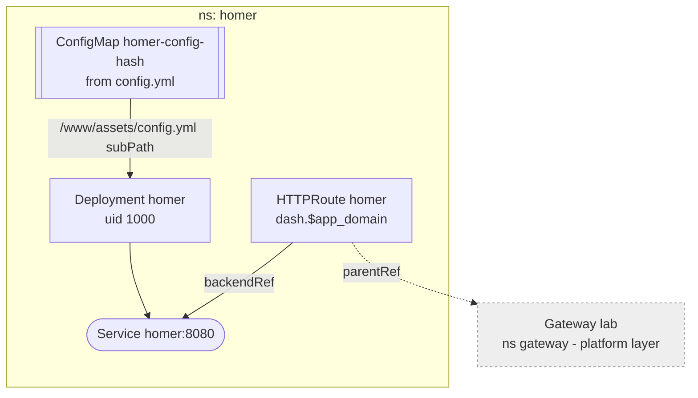

# Homer

Static link page for the lab, upstream `b4bz/homer` pinned by tag. No state,
no login: LAN and tailnet only, like everything behind the gateway.

## Config

`apps/homer/config.yml` is the whole page. A `configMapGenerator` turns it
into a ConfigMap whose name carries a content hash, so an edit rolls the pod
even though a `subPath` mount never updates in place. Flux substitutes
`${app_domain}` and `${lab_domain}` into it like any other manifest -- a
literal dollar sign must be written `$$`.

Only `config.yml` is mounted; the image's own assets stay, and
`INIT_ASSETS=0` keeps the entrypoint from trying to install defaults.

Logos load in the browser from the `homarr-labs/dashboard-icons` jsDelivr CDN,
pinned to a commit since that repo has no tags. Without internet they fall
back to the title; the links still work. Own apps use Font Awesome icons,
which ship in the image.

## Updates

Bump the tag in `apps/homer/server.yaml`.
