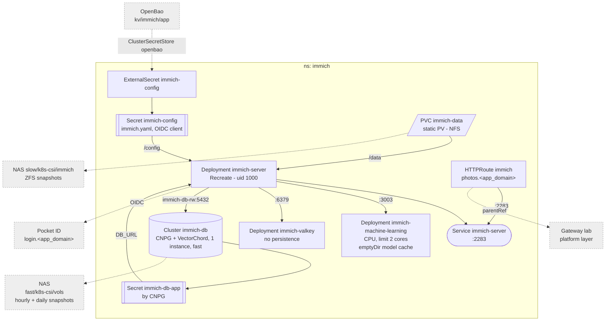

# Immich

Photos: phone backup, timeline, faces, smart search. Upstream's server and ML
images, a CNPG Postgres with VectorChord, Valkey for the job queue, SSO
through Pocket ID. All settings in one git-owned config file.

Why it looks like this:

- **Two stores.** Originals, thumbnails and encoded video on the NAS as a
  static `Retain` PV (like nextcloud's files); Postgres on `fast` through CNPG.
- **Config file, not the UI.** `IMMICH_CONFIG_FILE` makes every admin setting
  read-only. ESO renders it from `config.yaml` so the OIDC secret stays in
  OpenBao; `{{ "..." }}` there escapes Immich's own `{{y}}` template braces
  from ESO's Go template. Read at start only, so a change needs a restart.
- **Db role is superuser**, as upstream expects: Immich creates and updates
  `vchord` and `earthdistance` itself, so a VectorChord bump needs no manual
  `ALTER EXTENSION`. The image is tensorchord's CNPG build; `vchord.so` is
  preloaded.
- **ML on CPU, capped at 2 cores**, with every model job at concurrency 1:
  the first pass over an import takes long but leaves the node usable.
  Models download into an `emptyDir` again after a restart.
- **Valkey without persistence.** It holds the job queue only; Immich's
  nightly jobs re-find anything lost.
- **Runs as uid 1000**, as upstream's rootless compose; the NAS directory is
  owned by 1000.
- **`IMMICH_ALLOW_SETUP=false`**: no admin sign-up form. Admins come from
  Pocket ID's `immich_role` claim.
- **Immich's own db dumps off.** The zvol snapshots are the db's backup, as for
  every other CNPG db.

Users, break-glass, restore: [Immich](../../docs/src/workloads/immich.md).
