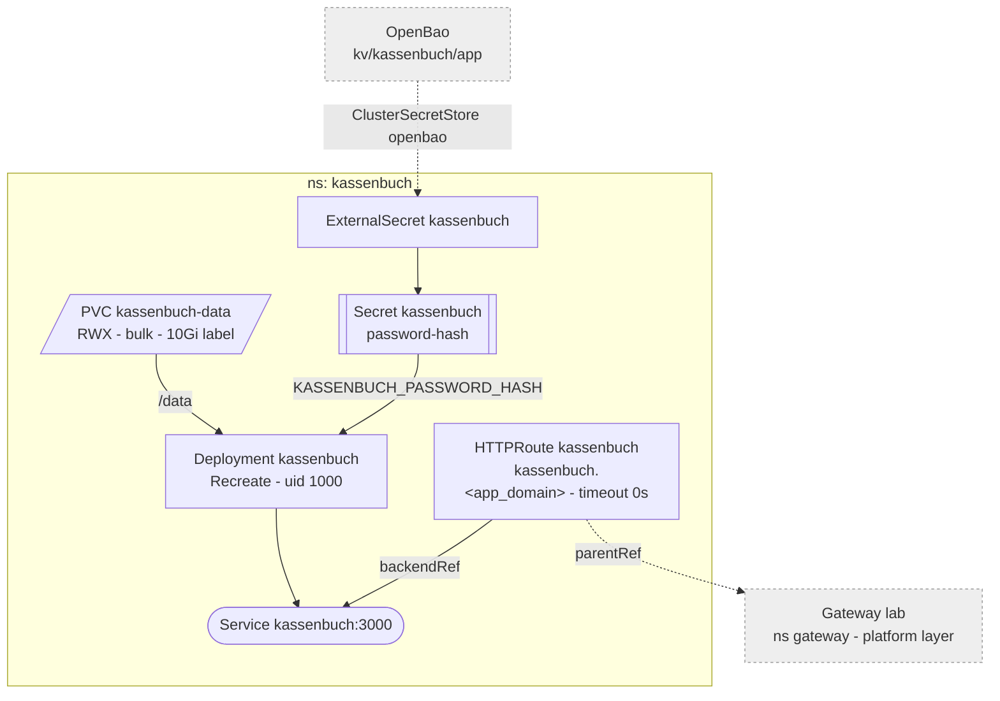

# Kassenbuch

Single-user Kassenbuch for the Verein. Image
`registry.<app_domain>/kassenbuch` from [zot](./zot.md), which allows
anonymous pulls, so there is no pull secret.

Why it looks like this:

- **`bulk`, not `fast`:** `/data` (`kassenbuch.db`, `belege/`, `exports/`)
  holds records with a retention duty, so it sits on the mirror under the NAS
  snapshots instead of the unmirrored NVMe. The 10Gi is a label.
- **One replica, `Recreate`:** SQLite on NFS holds only with one pod on one
  node over NFSv4.1.
- **`timeout 0s` on the HTTPRoute:** Envoy's 15s default cuts off large Beleg
  uploads and zip imports.
- **`KASSENBUCH_PASSWORD_HASH`** comes from `kv/kassenbuch/app` via the
  ExternalSecret; `ORIGIN` is plain env.

Password rotation, restore and updates:
[Kassenbuch](../../docs/src/workloads/kassenbuch.md).
