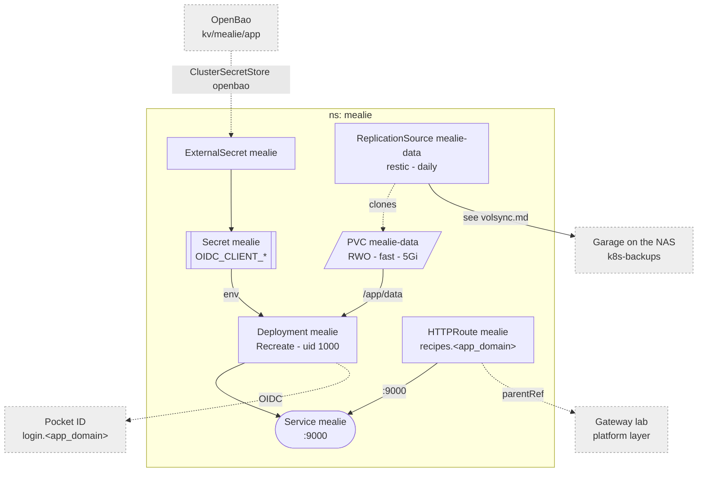

# Mealie

Recipes, meal plans, shopping lists. One Deployment behind the Gateway, SSO
through Pocket ID, configured by env.

Why it looks like this:

- **One volume.** `mealie-data` holds the SQLite db, recipe images and the
  signing secrets Mealie generates on first start -- on `fast`, with a
  `backup.yaml` (see [volsync](./volsync.md)). Images are few and small; a
  split onto the NAS would buy two restores that must line up.
- **Config is env** in `server.yaml`; Mealie has no config file. Only the
  Pocket ID client is a secret.
- **Runs as uid 1000.** The entrypoint only `chown`s + `gosu`s when started as
  root, so the image runs unchanged.
- **No metrics**: Mealie exposes none. `/api/app/about` (the image's own
  healthcheck) is the probe.
- **One pod, `Recreate`**: SQLite has one writer and the data volume is RWO.

Pocket ID client, users, restore: [Mealie](../../docs/src/workloads/mealie.md).
