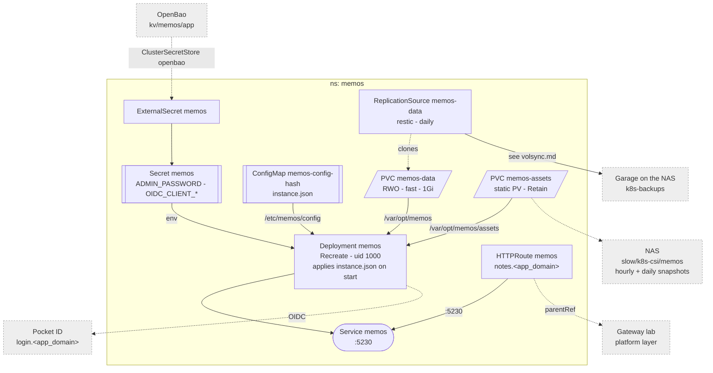

# Memos

Note taking. One Deployment behind the Gateway, SSO through Pocket ID, the
instance settings declared in git.

Why it looks like this:

- **Two volumes.** `memos-data` (the SQLite db) is on
  `fast` with a `backup.yaml` -- see [volsync](./volsync.md).
  `memos-assets` (attachments) is a static `Retain` PV on
  `/mnt/slow/k8s-csi/memos`, mounted over `assets/` of the data dir, which is
  memos' default attachment path. The directory is made by hand -- see
  [machines/truenas.md](../../machines/truenas.md).
- **Git owns the instance settings.** `instance.json` (a
  `configMapGenerator`, so a change rolls the pod) is memos' declarative
  config: Pocket ID as identity provider, private access, password auth off,
  local attachment storage, the `admin` user. Applied on every start; the
  admin UI refuses to change what it declares. `$${env:X}` in it is the Flux
  escape for memos' own `${env:X}`.
- **Runs as uid 1000**, so the image's root entrypoint skips its `chown` +
  `su-exec`.
- **No metrics**: memos exposes none. `/healthz` (pings the db) is the probe.
- **One pod, `Recreate`**: SQLite has one writer and the data volume is RWO.

Pocket ID client, users, restore: [Memos](../../docs/src/workloads/memos.md).
