# Monitoring

victoria-metrics-k8s-stack (`infrastructure/controllers/victoria-metrics/`):
the VictoriaMetrics operator, VMSingle, VMAgent, VMAlert, Alertmanager and
Grafana, plus the exporters for the cluster itself. Beside it, VictoriaLogs
and its collector vlagent (`infrastructure/controllers/victoria-logs/`) for
container logs, and oauth2-proxy in front of the UIs without a login.

Rules, scrapes and dashboards for things no app owns live in
`infrastructure/configs/`; an app's own sit beside it.

```mermaid
graph TD
  subgraph mon["ns: monitoring (privileged)"]
    OPR["vm-operator"]
    VM["VMSingle<br/>30d - sc fast 10Gi"]
    AG["VMAgent"]
    VMA["VMAlert"]
    AM["Alertmanager<br/>sc fast 1Gi"]
    GR["Grafana<br/>stateless - login only, admins"]
    VL["VictoriaLogs<br/>30d / 16GiB - sc fast 20Gi"]
    VA["vlagent<br/>DaemonSet, /var/log/containers"]
    NE["node-exporter<br/>DaemonSet"]
    KSM["kube-state-metrics"]
    O2P["oauth2-proxy<br/>one container per host"]
    SJ["sync-job<br/>chart rules, pinned tags"]
    SEC[["ExternalSecret grafana-admin<br/>kv/monitoring/grafana"]]
    SECA[["ExternalSecret alerting<br/>kv/monitoring/alerting"]]
    SECO[["ExternalSecret grafana-oidc<br/>kv/monitoring/grafana-oidc"]]
    SECP[["ExternalSecret oauth2-proxy<br/>kv/monitoring/oauth2-proxy"]]
    OPR -->|manages| VM & AG & VMA & AM
    SEC --> GR
    SECO -->|GF_AUTH_GENERIC_OAUTH_*| GR
    SECA -->|mounted as files| AM
    SECP -->|OAUTH2_PROXY_*| O2P
    AG -->|remote write| VM
    VMA -->|queries| VM
    VMA -->|alerts| AM
    GR -->|"queries, plugins from grafana.com"| VM & VL
    VA -->|"/insert/native"| VL
    O2P --> VM & VL & AM
    SJ -->|VMRule| VMA
  end

  SJ -.->|fetch| GH["raw.githubusercontent.com"]
  AG -->|scrapes| NE & KSM
  AG -->|scrapes| K["apiserver - kubelet/cAdvisor - CoreDNS"]
  AG -.->|any namespace| MON["VMServiceScrape - VMPodScrape<br/>VMScrapeConfig - VMRule"]
  GR -.->|any namespace| DASH["ConfigMap<br/>grafana_dashboard: 1"]
  CFG["infrastructure/configs/dashboards"] -->|configMapGenerator| DASH
  NAS["infrastructure/configs/nas<br/>VMScrapeConfig - VMRule"] --> MON
  PVE["infrastructure/configs/proxmox<br/>VMScrapeConfig - VMRule"] --> MON
  GA["infrastructure/configs/garage<br/>VMScrapeConfig - VMRule"] --> MON
  VLR["infrastructure/configs/victoria-logs<br/>VMRule"] --> MON
  AG -->|scrapes :9100| TN["TrueNAS node-exporter<br/>10.212.4.150 - see machines/truenas.md"]
  AG -->|"scrapes :3903/metrics, bearer"| GS["Garage on the NAS<br/>s3-k8s - see machines/truenas.md"]
  AG -->|scrapes :9100 - :9221<br/>via metrics-allow-proxmox| PX["Proxmox hosts<br/>node-exporter + pve-exporter"]

  AM -->|critical: sound<br/>everything else: silent| TG["Telegram group"]
  AM -->|Watchdog, every 5m| HB["Cronitor heartbeat<br/>outside the lab, emails on silence"]

  GR & O2P -->|OIDC| PID["Pocket ID<br/>login.&lt;app_domain&gt; - see pocket-id.md"]
  GW["Gateway lab"] -->|grafana.&lt;app_domain&gt;| GR
  GW -->|"metrics. - logs. - alertmanager.&lt;app_domain&gt;"| O2P
```

Why it looks like this:

- **Native kinds only.** The operator's Prometheus converter is off and no
  `monitoring.coreos.com` CRD is installed: a `VMScrapeConfig` has no
  `jobName`, so each one relabels `job` itself -- rules and dashboards match
  on it.
- **Retention 30d** on a 10Gi `fast` PVC. VMSingle has no size cap; the
  chart's PVC-filling alert is the guard.
- **Chart rules are pinned.** The chart's sync-job fetches its default rules
  from GitHub at deploy time; `release.yaml` pins every source URL to a tag
  with a `# renovate:` comment.
- **Dashboards:** the chart's own are off. Ours are JSON files flat in
  `infrastructure/configs/dashboards/`, each a `configMapGenerator` entry
  labelled `grafana_dashboard: "1"`; the sidecar picks them up in any
  namespace. Grafana is stateless (emptyDir), so the files are the truth.
  They query datasource uid `victoriametrics` (the
  `victoriametrics-metrics-datasource` plugin).
- **Alertmanager secrets are mounted as files** (`kv/monitoring/alerting`:
  bot token, heartbeat URL) under `/etc/vm/secrets/alerting/` and read via
  `*_file` options; the Telegram chat id travels in `cluster-vars` -- no
  credential, but it names a private group.
- **Heartbeat is Cronitor**: `Watchdog` pings the URL the vault holds; when
  pings stop, Cronitor emails.
- **Every lab rule carries `origin: lab`**, which the chart's do not -- the
  one matcher that finds or routes ours.
- **VMAgent and VMAlert select across all namespaces**
  (`selectAllByDefault`), so a scrape or rule beside its app is picked up.
- **Grafana's own alerting is unused**: a rule made in its UI dies with the
  pod.
- **Logs: VictoriaLogs + vlagent**, both single binaries from one vendor, two
  HelmReleases with `dependsOn: victoria-metrics` (their scrape CRDs).
- **oauth2-proxy, one pod, three containers**: it routes upstreams by path,
  not host, so each hostname gets its own listener. One Pocket ID client,
  one cookie secret, cookie domain `.<app_domain>`.

Access, routing, alerts, dashboards and how to change them:
[Monitoring](../../docs/src/monitoring.md).
