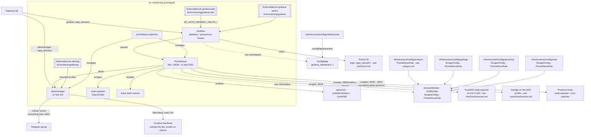

# Monitoring

kube-prometheus-stack: Prometheus, Alertmanager and Grafana, plus the exporters
for the cluster itself.

Rules, scrapes and dashboards for things no app owns live in
`infrastructure/configs/`; an app's own sit beside it. Prometheus has no
route.

Why it looks like this:

- **Retention 30d or 18GB**, whichever first, on a 20Gi `fast` PVC -- the size
  cap keeps the TSDB inside its volume; long history is not needed.
- **Dashboards:** the chart's own are off. Ours are JSON files flat in
  `infrastructure/configs/dashboards/`, each a `configMapGenerator` entry
  labelled `grafana_dashboard: "1"`; the sidecar picks them up in any
  namespace. Grafana is stateless (emptyDir), so the files are the truth.
- **Alertmanager secrets are mounted as files** (`kv/monitoring/alerting`:
  bot token, heartbeat URL) and read via `*_file` options; the Telegram chat
  id travels in `cluster-vars` -- no credential, but it names a private group.
- **Heartbeat is Cronitor**: `Watchdog` pings the URL the vault holds; when
  pings stop, Cronitor emails.
- **Every lab rule carries `origin: lab`**, which the chart's ~134 do not --
  the one matcher that finds or routes ours.
- **Prometheus selects across all namespaces** (`*SelectorNilUsesHelmValues:
  false`), so a ServiceMonitor, PodMonitor, ScrapeConfig or PrometheusRule
  beside its app is picked up.
- **Grafana's own alerting is unused**: a rule made in its UI dies with the
  pod.

Access, routing, alerts, dashboards and how to change them:
[Monitoring](../../docs/src/monitoring.md).
