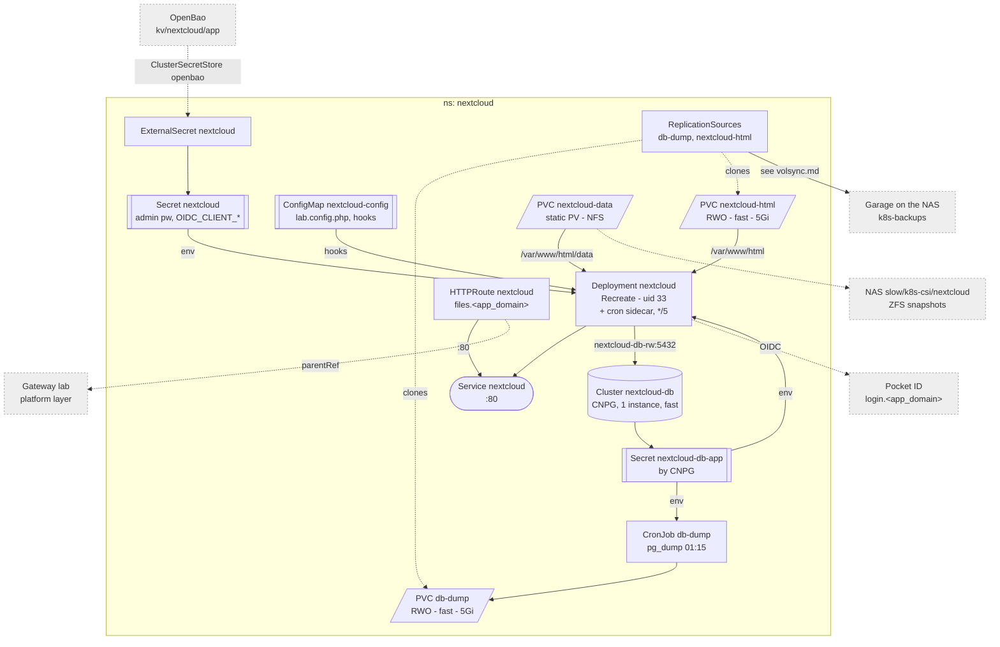

# Nextcloud

Files only: web UI, share links, desktop and mobile sync. The official apache
image, a CNPG Postgres, SSO through Pocket ID. Config is env plus one
git-owned config file and a start hook.

Why it looks like this:

- **Three stores.** Files on the NAS as a static `Retain` PV (like memos'
  attachments); `/var/www/html` on `fast` for code, `config.php` and apps;
  Postgres on `fast` through CNPG.
- **`lab.config.php`** is read after `config.php` and wins. A hook copies it
  into `config/` before install and on every start; a subPath mount would
  make kubelet create `config/` as root and break the install. It holds the db
  connection from env, so a rebuilt `Cluster` with a new CNPG password needs
  no edit. The ConfigMap has Flux substitution off: `$` there is PHP and
  shell, not Flux variables.
- **The start hook** (`before-starting`) runs on every start, after any
  install or upgrade: background jobs to cron, the unused default apps off,
  `user_oidc` installed and its provider written from env.
- **Runs as uid 33** (www-data) from the start, so the entrypoint skips its
  chown; `net.ipv4.ip_unprivileged_port_start=0` lets Apache keep port 80.
- **Background jobs** are a sidecar looping `cron.php` every 5 minutes: same
  version and node as the server, stops with it. Not the image's `/cron.sh`
  (busybox crond needs root), not a CronJob (would need the RWO volume's node,
  and runs mid-install/upgrade).
- **No Redis.** APCu (the image's default) for the local cache, the db for
  file locking -- enough for a household.
- **Backup** is a nightly `pg_dump` with CNPG's own image (same major), then
  VolSync, as for DHS. CNPG's backup feature is not used.

Users, break-glass, restore: [Nextcloud](../../docs/src/workloads/nextcloud.md).
