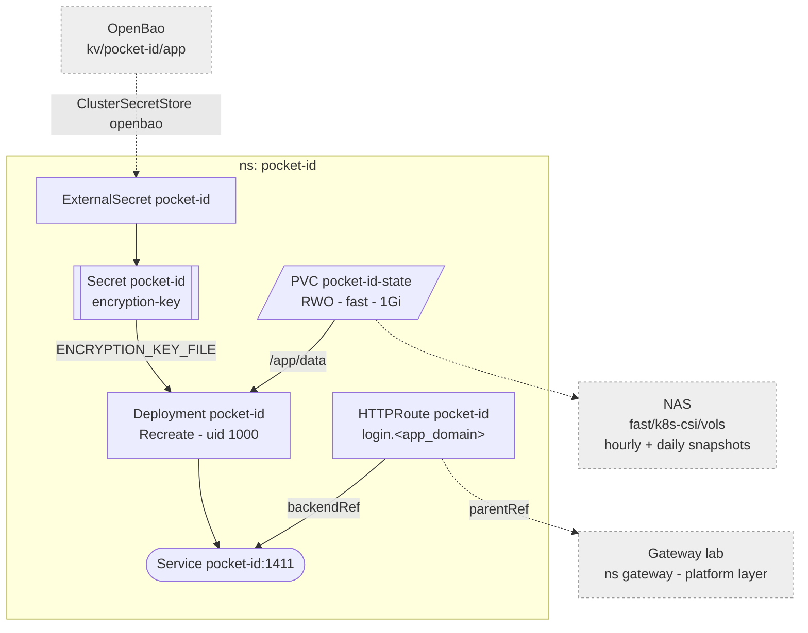

# Pocket ID

OIDC provider for the lab, passkeys only. In `infrastructure/controllers/`,
not `apps/`, so its Flux Kustomization is `infrastructure`.

Why it looks like this:

- **`fast`**: `pocket-id.db` (SQLite, WAL) and uploads on a block device, so
  none of SQLite's NFS caveats apply. One pod, `Recreate`.
- **`ENCRYPTION_KEY_FILE`** points at the Secret mount; the key is generated in
  `platform_secrets.tf` and the database is unreadable without it.

Users, clients, break-glass, restore and updates:
[Pocket ID](../../docs/src/platform/pocket-id.md).
