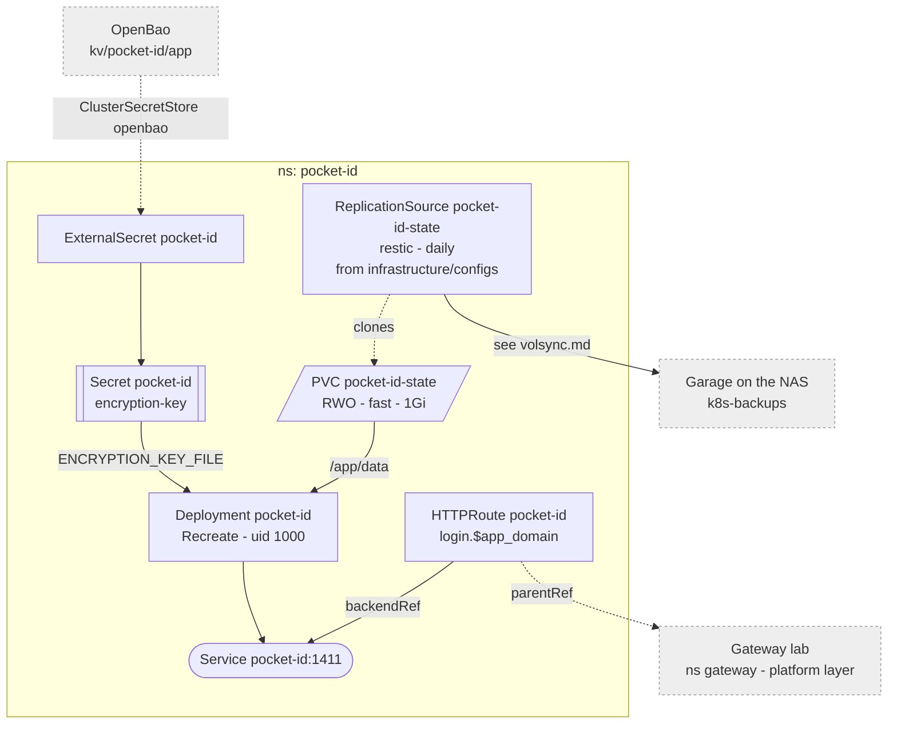

# Pocket ID

OIDC provider for the lab, passkeys only. An extra way in, not the only one:
every app keeps its own admin login as break-glass, so Pocket ID being down
locks nobody out. Served at `login.${app_domain}`, LAN and tailnet only.



## Storage

One `fast` PVC for `/app/data`: `pocket-id.db` (SQLite, WAL) and uploads. A
block device, so none of SQLite's NFS caveats apply.

Backed up nightly by VolSync into Garage -- see [volsync.md](./volsync.md).
The ReplicationSource is in `infrastructure/configs/pocket-id/`, not here:
this directory is applied in the same pass as the chart that installs its
kind. Without the backup, losing it means every passkey enrolled again and
every client re-registered; the apps' admin logins cover the gap.

The encryption key is generated in `platform_secrets.tf`; the database is
unreadable without it, and the tofu state is its backup.

## First start

`/setup` creates the first admin -- whoever opens it first. Do it right after
the first deploy.

## Users

No signups and no SMTP. Users and groups are created in the admin UI; each
person gets a one-time login link and enrolls a passkey with it.

| Group       | Meaning                       |
|-------------|-------------------------------|
| `admins`    | admin in the apps that map it |
| `household` | everyone else                 |

A lost passkey: issue a new one-time link. Your own admin passkey lost:

```sh
kubectl -n pocket-id exec deploy/pocket-id -- /app/pocket-id one-time-access-token <username>
```

## Clients

Registered by hand in the admin UI. The secret goes to OpenBao only when the
app reads its OIDC settings from config rather than its own database:

ansible vault -> `platform_secrets.tf` -> `kv/<ns>/<app>` -> `ExternalSecret`

Losing a client secret costs a re-registration, not access.

| Client  | Groups              | Configured in                                        | Break-glass  |
|---------|---------------------|------------------------------------------------------|--------------|
| Grafana | `admins`, `household` | [monitoring](./monitoring.md)                      | admin form   |
| OpenBao | `admins`            | `platform_openbao.tf`, see platform/README.md        | root token   |
| Proxmox | `admins`            | by hand, see machines/proxmox.md                     | `root@pam`   |
| PBS     | `admins`            | by hand, see guests/README.md                        | `root@pam`   |

TrueNAS has no OIDC login.

## Updates

The image tag is pinned; Renovate proposes bumps.
