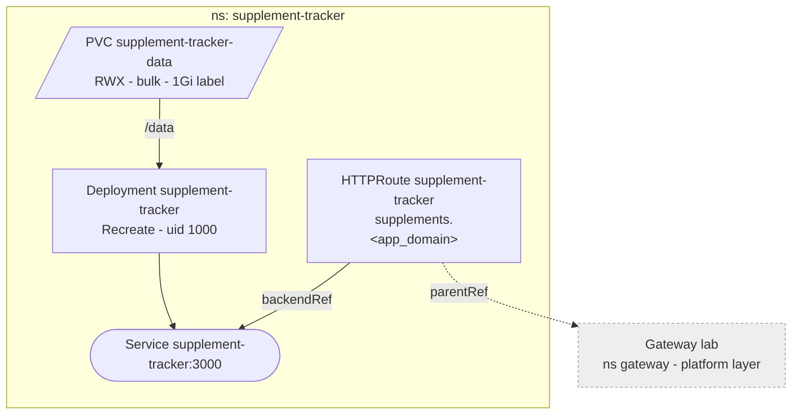

# Supplement tracker

The household's supplement plan. Image
`registry.<app_domain>/supplement-tracker` from [zot](./zot.md), which allows
anonymous pulls, so there is no pull secret. No secrets, so no
ExternalSecret.

Why it looks like this:

- **`bulk`:** `/data` holds only `supplements.db` (SQLite, WAL), and the app
  has no export, so the NAS snapshots are its only backup. The 1Gi is a label.
- **One replica, `Recreate`:** SQLite on NFS holds only with one pod on one
  node over NFSv4.1.
- **Probes hit `/healthz`**, which runs a query. `ORIGIN` is the only env.

Restore and updates:
[Supplement tracker](../../docs/src/workloads/supplement-tracker.md).
