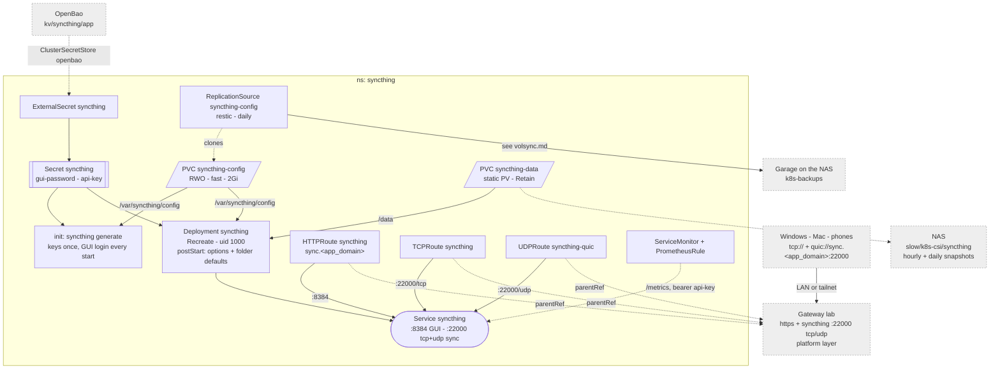

# Syncthing

The household's always-on sync hub. GUI over HTTPS on the Gateway, sync on
the Gateway's `syncthing` / `syncthing-quic` listeners (`:22000` tcp + udp).

Why it looks like this:

- **Two volumes, split by what SQLite tolerates.** `syncthing-data` (the
  files) is a static PV on `/mnt/slow/k8s-csi/syncthing` with `Retain`, not a
  `bulk` PVC: deleting the PVC, the namespace or the app leaves the directory,
  and a rebuild re-binds it by name. csi-driver-nfs only mkdirs what it
  provisions, so the directory is made by hand -- see
  [machines/truenas.md](../../machines/truenas.md). `syncthing-config` (keys,
  `config.xml`, index db) is on `fast` for SQLite, with a `backup.yaml` --
  see [volsync](./volsync.md).
- **Git owns part of the GUI's config.** The init container runs `syncthing
  generate` (keys once, GUI login every start); `postStart` re-applies the
  options (listen addresses, discovery/relays/NAT/reporting off, folder
  defaults: `/data/`, 7-day trash can). A GUI change to those is undone on
  restart. `STNOUPGRADE=1`: the tag in `server.yaml` is the version.
- **The TCP/UDP routes carry no hostname**: syncthing's TLS sends no SNI, so
  any name on the Gateway's address reaches `:22000`.
- **Metrics** are scraped with the API key as bearer token
  (`monitoring.yaml`, beside the rules).
- **One pod, `Recreate`**: SQLite has one writer and the config volume is RWO.

Folder layout, adding devices, restore and alerts:
[Syncthing](../../docs/src/workloads/syncthing.md).
