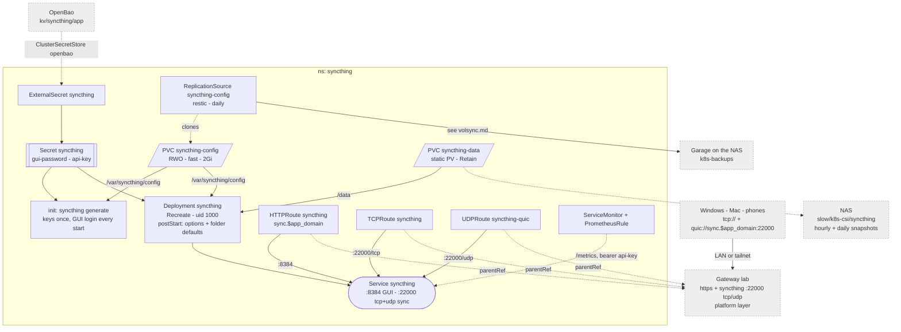

# Syncthing

The household's self-hosted cloud: an always-on syncthing peer every device
syncs with, so devices that are never online together still converge, and
every file has a copy on the NAS. One instance for everyone; the GUI at
`https://sync.${app_domain}` is the admin's. LAN and tailnet only -- no
global discovery, no relays.



## Storage

Two volumes, split by what SQLite tolerates:

- **`syncthing-data`** -- the files, on the NAS at `slow/k8s-csi/syncthing/`.
  A static PV with `Retain`, not a `bulk` PVC: a deleted PVC, namespace or
  app leaves the directory, and a rebuild re-binds it by name. The directory
  is made by hand -- see machines/truenas.md.
  Protected by the `k8s-csi` snapshot task (hourly 24h, daily 30d).
- **`syncthing-config`** -- keys, `config.xml`, the index db. On `fast`,
  backed up nightly by VolSync. The keys are the hub's device id: lost, every
  device has to be paired again. The db alone is rebuilt by a rescan.

Layout under `/data`:

```
/data/
├── <person>/documents/
├── <person>/media/
└── shared/             both people's devices
```

One syncthing folder per directory, so a phone can take `documents` and leave
`media` alone.

## What git owns

The rest of the config is the GUI's, saved in `config.xml` and backed up with
it. Re-applied from `server.yaml` on every start, so changing these in the GUI
does not survive a restart:

- GUI user `admin`, password from OpenBao (`kv/syncthing/app`, generated in
  `platform_secrets.tf`)
- listen on `tcp://` and `quic://0.0.0.0:22000`; global and local discovery,
  relays, NAT traversal, usage reporting and crash reporting off
- new folders default to `/data/` and a 7-day trash can (`.stversions/`)

GUI password:

```sh
kubectl -n syncthing get secret syncthing -o jsonpath='{.data.gui-password}' | base64 -d
```

## Adding a device

On the device, install syncthing, then add the hub as a remote device:

- device id: the hub's, from the GUI (*Actions -> Show ID*)
- addresses: `tcp://sync.${app_domain}:22000, quic://sync.${app_domain}:22000`
  -- not `dynamic`, there is no discovery to find it

Accept the device in the hub's GUI, then share that person's folders with it.
On the device, accept the folders and pick where they live locally.

Clients: Windows and macOS the official builds (or SyncTrayzor /
syncthing-macos), Android Syncthing-Fork, iOS Möbius Sync or Synctrain. iOS
syncs only while the app runs; phones take documents, not the camera roll.

Away from home a device syncs over the tailnet; without it, once it is home.

## Restore

- **A file deleted or overwritten in the last 7 days:** the folder's
  `.stversions/` on any device, or *Versions* in the hub's GUI.
- **Older, or many files:** the NAS snapshots,
  `.zfs/snapshot/<name>/syncthing/` under `slow/k8s-csi`. Copy back into
  `/data`; syncthing sends it out like any change.
- **Config or keys:** [volsync.md](./volsync.md), with the deployment scaled
  to 0.

## Alerts

`monitoring.yaml`, scraped with the API key as bearer token:

| Alert                      | When                                    |
|----------------------------|-----------------------------------------|
| `SyncthingDown`            | not scraped for 10m                     |
| `SyncthingFolderError`     | a folder in error state for 1h          |
| `SyncthingFolderOutOfSync` | the hub still needs data after 6h        |
| `SyncthingDeviceUnseen`    | a device not connected once in 7 days   |

`SyncthingDeviceUnseen` reads `syncthing_connections_active`, which appears
only once a device connects after a restart -- a device that never returns
after one is not caught.

## Not enabled

- **SSO via Pocket ID.** Syncthing has no OIDC; it would take an
  oauth2-proxy in front, passing a fixed basic-auth header upstream.
- **Camera roll upload.** Later, maybe Immich, which can import the synced
  folders as an external library.
