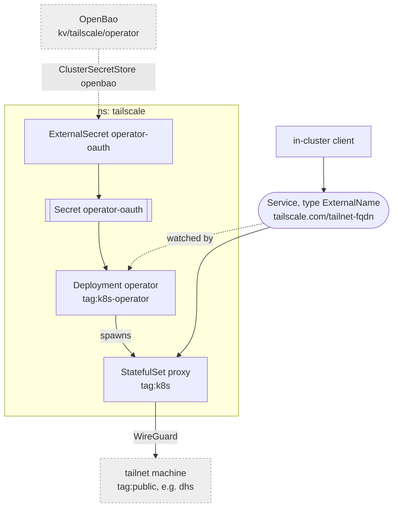

# Tailscale

The tailscale operator, egress only: it lets the cluster reach tailnet machines
the LAN has no route to -- public boxes, which open nothing toward the lab and
so must be pulled from. Nothing in the cluster is exposed to the tailnet
through it; the tailnet reaches the lab through the `vpn` router instead.



## Access

What a proxy may reach is decided by the tailnet policy, not here -- see
[network](../../network/README.md#tailnet). `tag:k8s` gets only named ports on
named tags.

## Reaching a machine

An `ExternalName` Service beside the consumer, in its namespace -- e.g.
`apps/dhs/egress.yaml`. `${tailnet_domain}` comes from `cluster-vars`: it names
the tailnet, and this repo is public.

```yaml
apiVersion: v1
kind: Service
metadata:
  name: <machine>
  annotations:
    tailscale.com/tailnet-fqdn: <machine>.${tailnet_domain}
spec:
  type: ExternalName
  externalName: placeholder # the operator rewrites it
```

The operator spawns one proxy per Service, in `tailscale`, and points the
Service at it.

## Setup

One OAuth client in the tailscale console, separate from the network layer's:
scopes `devices:core`, `auth_keys` and `services` (write), tag
`tag:k8s-operator`. Its id and secret go in `secrets/vault.yml` as
`tailscale_operator_client_id` and `tailscale_operator_client_secret`; the
platform layer writes them into OpenBao.
