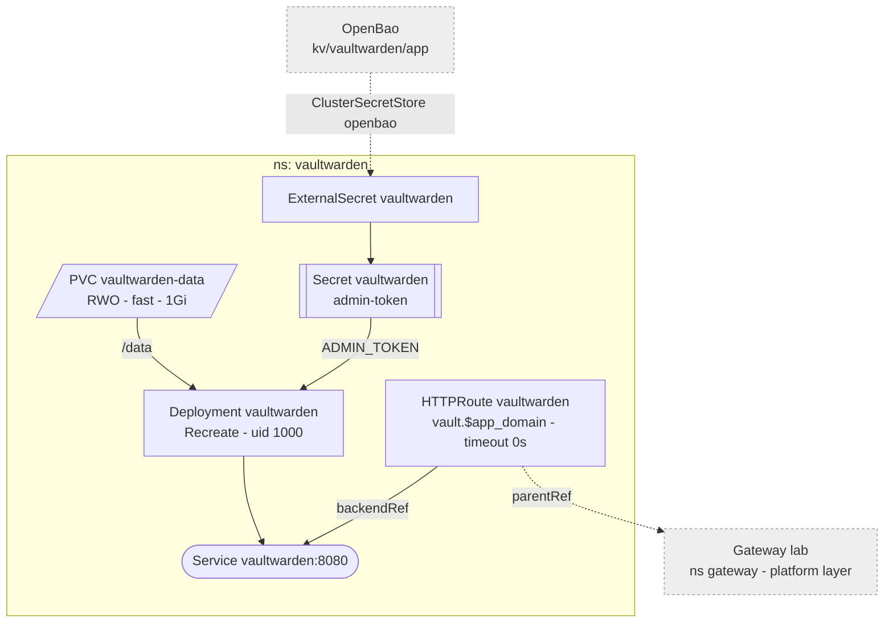

# Vaultwarden

Bitwarden-compatible password manager for the household; the official
Bitwarden apps and browser extensions point at `https://vault.${app_domain}`.
LAN and tailnet only, like everything behind the gateway.



## Storage

One `fast` PVC for all of `/data`: `db.sqlite3` (SQLite, WAL), `rsa_key.pem`
(signs login tokens), `attachments/`, `sends/`, `icon_cache/`. A block
device, so none of SQLite's NFS caveats apply.

**No backup yet.** `fast` is one unmirrored NVMe with no restore path; a dead
drive, a deleted PVC or a bad migration loses the server's data. The vault
items themselves survive in every client's offline cache and can be exported
from there, attachments and Sends do not. Closed by the pool-wide `fast`
backup, not by anything here.

1Gi is plenty for the db and icons; attachments are what grows. `fast`
allows expansion -- raise the request in `storage.yaml`.
`KubePersistentVolumeFillingUp` warns first.

## Accounts

No signups and no SMTP. Invite an email in `/admin` -> Users; without mail
the invite is not sent, but that email may now register at the login page.
Each user then sets a master password and enrolls a passkey as 2FA
(Settings -> Security -> Two-step login -> FIDO2 WebAuthn).

The master password is the vault's encryption key: forgotten, that vault is
gone. `/admin` can delete the account, never open it.

## Admin token

`/admin` takes the plaintext; the app reads only its argon2id hash from
`ADMIN_TOKEN`. The plaintext lives offline -- not in Vaultwarden itself, or a
broken Vaultwarden locks out its own recovery. The hash sits in
`secrets/vault.yml` as `vaultwarden_admin_token_hash`, from where
`platform_secrets.tf` writes it to OpenBao at `kv/vaultwarden/app`.

Set or rotate:

```sh
docker run --rm -it docker.io/vaultwarden/server:<tag> /vaultwarden hash
ansible-vault edit secrets/vault.yml      # vaultwarden_admin_token_hash: $argon2id$... (unquoted)
mise run platform apply
kubectl -n vaultwarden annotate externalsecret vaultwarden force-sync=$(date +%s) --overwrite
kubectl -n vaultwarden rollout restart deploy/vaultwarden   # env is read at start
```

Settings saved in `/admin` land in `/data/config.json` and override env.

## Not enabled

- **SSO via Pocket ID.** With password login kept as break-glass it adds
  convenience, not security. Later: a Pocket ID client, `SSO_ENABLED`,
  `SSO_AUTHORITY=https://login.${app_domain}`, the client id/secret through
  OpenBao.
- **Mobile push.** Phones sync on open and periodically instead. Later:
  installation id/key from `bitwarden.com/host`, `PUSH_ENABLED`.

## Updates

The image tag is pinned; Renovate proposes bumps. Migrations run on start.
