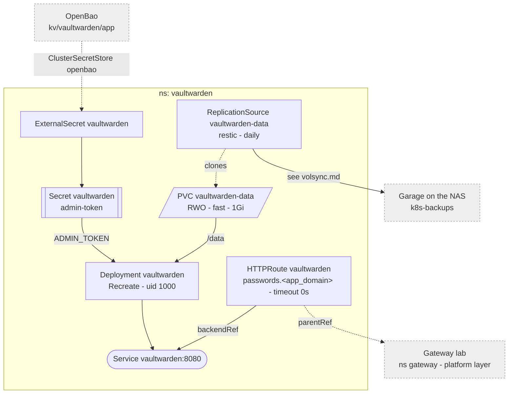

# Vaultwarden

Bitwarden-compatible password manager for the household.

Why it looks like this:

- **`fast`**: all of `/data` (`db.sqlite3`, `rsa_key.pem`, `attachments/`,
  `sends/`, `icon_cache/`) on a block device, so none of SQLite's NFS caveats
  apply. `fast` has no copy elsewhere, hence `backup.yaml` -- see
  [volsync](./volsync.md). One pod, `Recreate`.
- **`ADMIN_TOKEN`** is an argon2id hash from `kv/vaultwarden/app`, never the
  plaintext.
- **`SIGNUPS_ALLOWED=false`, `INVITATIONS_ALLOWED=true`**, no SMTP: an account
  exists only for an invited email.
- **`DOMAIN`** binds WebAuthn credentials to the URL; **`IP_HEADER:
  X-Forwarded-For`**, which Envoy appends, so rate limits see the real IP.
- **`timeout 0s` on the HTTPRoute**: Envoy's 15s default cuts off big
  attachments.

Accounts, the admin token, restore and updates:
[Vaultwarden](../../docs/src/workloads/vaultwarden.md).
