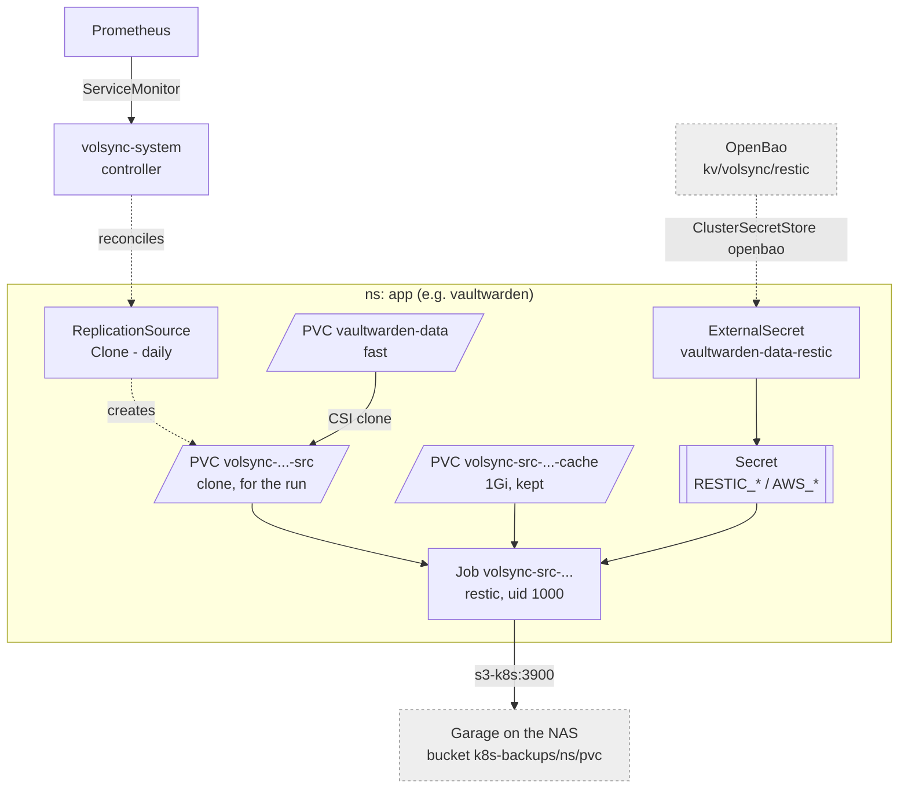

# VolSync

Backups of the `fast` PVCs that cannot be rebuilt: restic, nightly, into
Garage on the NAS's `slow` mirror. `fast` itself has no copy anywhere else, and
a ZFS snapshot there dies with the zvol -- `kubectl delete pvc` included.

| PVC                | Namespace     | Schedule (UTC) | Defined in                                     |
|--------------------|---------------|----------------|------------------------------------------------|
| `vaultwarden-data` | `vaultwarden` | `00:15`        | `apps/vaultwarden/backup.yaml`                 |
| `syncthing-config` | `syncthing`   | `00:30`        | `apps/syncthing/backup.yaml`                   |
| `pocket-id-state`  | `pocket-id`   | `00:45`        | `infrastructure/configs/pocket-id/backup.yaml` |
| `postgres-dump`    | `dhs`         | `01:00`        | `apps/dhs/backup.yaml`                         |

Not backed up: OpenBao (tofu rebuilds it from the vault), Prometheus and
Alertmanager (history only), and `bulk` (on the mirror, under the NAS
snapshot tasks). A new `fast` PVC that cannot be rebuilt gets a `backup.yaml`
beside it.



## How a run works

At the scheduled time the controller clones the PVC, starts a restic Job on
the clone in the app's namespace, runs `backup` then `forget` per `retain`
(`daily 14, weekly 8, monthly 6`; `prune` every 7 days), and deletes the clone
and the Job. A repository is initialised on its first run. The cache PVC stays
for as long as the ReplicationSource does.

`copyMethod: Clone`, not `Snapshot`. `Snapshot` restores a VolumeSnapshot into
a new PVC, which democratic-csi does with a detached `send | recv` -- and
TrueNAS refuses that on the encrypted pool (*"Destination dataset must be
encrypted"*). A clone is a plain `zfs clone`, which inherits the encryption and
pins its origin only for the length of the run.

The copy is crash-consistent: what is on disk at that moment, like pulling the
plug. SQLite fsyncs its commits, so both apps are fine; the DHS dump is written
aside, synced and renamed. Anything that does not
fsync loses whatever the page cache was still holding -- the drill caught a
freshly written file going in as 0 bytes.

## Credentials

One Garage key (`volsync`, on bucket `k8s-backups`, quota 50G) and one restic
password for every repository. All three come from `secrets/vault.yml`
(`garage_volsync_key_id`, `garage_volsync_secret_key`,
`volsync_restic_password`), and `platform_secrets.tf` writes them to
`kv/volsync/restic`. Each app's ExternalSecret adds its own
`RESTIC_REPOSITORY`.

**Losing the restic password makes every backup unreadable.** Anything that
can read one app's Secret can delete every app's backups; the daily snapshot
task on `slow/garage` (7d) is what survives that.

## Monitoring

- `VolSyncBackupFailing` -- a source is out of sync for 1h (a failed or missed
  run). Warning.
- `VolSyncMetricsAbsent` -- no sync status at all, so the controller or the
  scrape is dead. Warning.

Metrics auth is off: the chart's ServiceMonitor sends no token.

```sh
kubectl get replicationsource -A
kubectl -n <ns> get replicationsource <pvc> -o jsonpath='{.status.latestMoverStatus.logs}'
```

## Restore

Into an existing, empty PVC with `copyMethod: Direct` -- never through a
volume populator, which restores via a VolumeSnapshot and fails like
`Snapshot` above.

1. Suspend the app so Flux does not scale it back up. Pocket ID lives in the
   `infrastructure` Kustomization, so that suspends every controller with it.
   ```sh
   flux suspend kustomization vaultwarden
   kubectl -n vaultwarden scale deploy/vaultwarden --replicas=0
   ```
2. Apply a `ReplicationDestination` (below), pointed at the app's PVC -- it is
   overwritten in place. If the PVC is gone, create it empty first. Optionally
   set `restic.restoreAsOf` (RFC 3339) for an older snapshot.
3. Wait for `status.lastManualSync == restore-1`, read `latestMoverStatus`.
4. Delete the `ReplicationDestination` (its cache PVC goes with it), then
   `flux resume kustomization vaultwarden`.

```yaml
apiVersion: volsync.backube/v1alpha1
kind: ReplicationDestination
metadata:
  name: vaultwarden-data
  namespace: vaultwarden
spec:
  trigger: { manual: restore-1 }
  restic:
    repository: vaultwarden-data-restic
    copyMethod: Direct
    destinationPVC: vaultwarden-data
    moverSecurityContext:
      runAsNonRoot: true
      runAsUser: 1000
      runAsGroup: 1000
      fsGroup: 1000
      seccompProfile: { type: RuntimeDefault }
```

Without the cluster: the repository is plain restic.

```sh
export RESTIC_REPOSITORY=s3:https://s3.<lab_domain>:3900/k8s-backups/vaultwarden/vaultwarden-data
export RESTIC_PASSWORD=... AWS_ACCESS_KEY_ID=... AWS_SECRET_ACCESS_KEY=... AWS_DEFAULT_REGION=lab
restic snapshots
restic restore latest --target ./restore
```

## Drill

Done once at rollout, in a throwaway `volsync-drill` namespace: write 10 MiB
plus its `sha256` into a `fast` PVC, back it up with a manual trigger, delete
the PVC (the PV went within seconds), restore with `Direct` into a new empty
PVC, `sha256sum -c` -> `OK`. Repeat it the same way if the setup changes: the
ReplicationSource and ReplicationDestination above with `trigger.manual`,
repository `k8s-backups/volsync-drill/drill-data`, and `sync` in the writer
before the backup. Afterwards delete the namespace and the prefix:

```sh
mise run s3 volsync rm --recursive --dryrun s3://k8s-backups/volsync-drill/
mise run s3 volsync rm --recursive s3://k8s-backups/volsync-drill/
```

`mise run s3 <key> <aws s3 args>` is the lab repo's wrapper: endpoint, region
and the key pair from `secrets/vault.yml`.

## Removing an app

Its ReplicationSource goes with it; the repository in Garage stays, on purpose
-- it is the undo for a deleted PVC. Once the app is gone for good, remove
`k8s-backups/<ns>/<pvc>/` the same way.

## Gotchas

- **Changing `copyMethod` mid-run** leaves the old run's Job, `volsync-*-src`
  PVC and VolumeSnapshot behind, and the new run reuses them. Delete all three;
  VolSync recreates what it needs.
- **The first run starts at creation**, not at the schedule.
