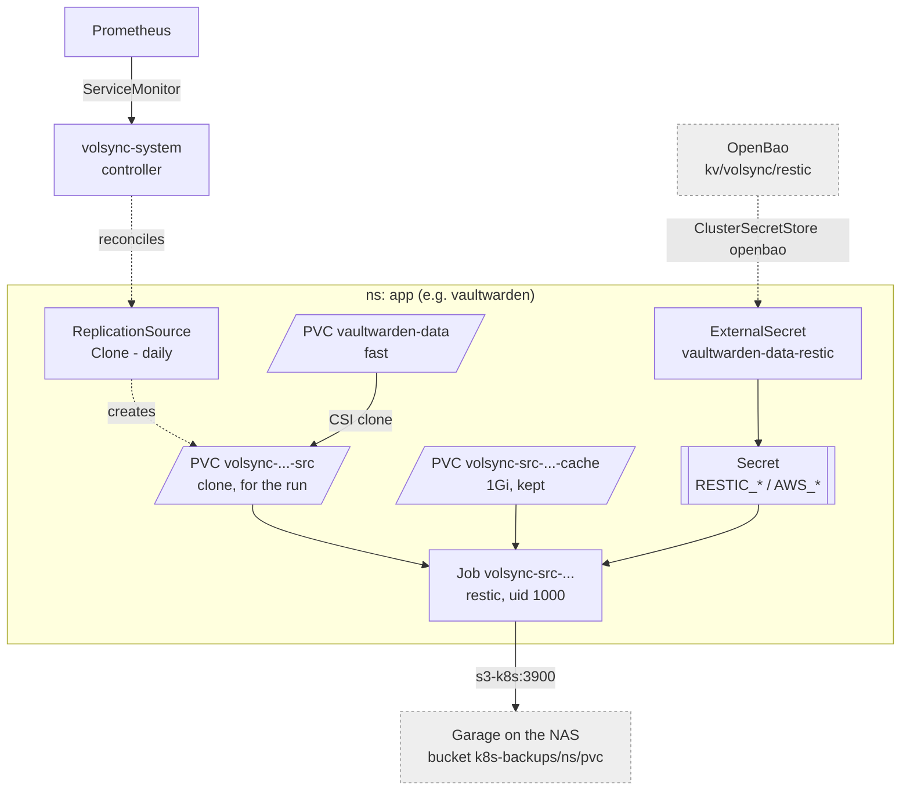

# VolSync

Backs up the `fast` PVCs that cannot be rebuilt: restic, nightly, into Garage
on the NAS. The controller is a HelmRelease in
`infrastructure/controllers/volsync/` (it installs the CRDs and watches every
namespace); its alerts are in `infrastructure/configs/volsync/`. Which PVCs,
schedules, retention, credentials, restore and drill:
[Backups, VolSync](../../docs/src/backups.md#volsync).

## The per-app pattern

A backed-up PVC gets a `backup.yaml` beside its `storage.yaml`, holding two
objects -- `apps/vaultwarden/backup.yaml` carries the comments:

- **`ExternalSecret <pvc>-restic`** -- templates `RESTIC_REPOSITORY`
  (`s3:https://s3-k8s.${lab_domain}:3900/k8s-backups/<ns>/<pvc>`),
  `RESTIC_PASSWORD` and the `AWS_*` keys from the one shared
  `kv/volsync/restic`. Only the repository path differs per app.
- **`ReplicationSource <pvc>`** -- `sourcePVC`, a `schedule` trigger (UTC,
  staggered so runs do not overlap), `copyMethod: Clone`,
  `storageClassName: fast`, `retain` + `pruneIntervalDays`, and a
  `moverSecurityContext` with the app's own uid so the mover needs no
  privileges.

Pocket ID's lives in `infrastructure/configs/pocket-id/` instead: its app is
in the same tier as the VolSync chart, and a CR cannot be applied in the same
pass as the chart that defines its kind.

## Why `Clone`

`copyMethod: Clone`, not `Snapshot`. `Snapshot` restores a VolumeSnapshot into
a new PVC, which democratic-csi does with a detached `send | recv` -- and
TrueNAS refuses that on the encrypted pool (*"Destination dataset must be
encrypted"*). A clone is a plain `zfs clone`, which inherits the encryption and
pins its origin only for the length of the run. Restores use `copyMethod:
Direct` into an existing PVC for the same reason -- never a volume populator.

## Metrics

The chart's ServiceMonitor sends no token, so metrics auth is off.
