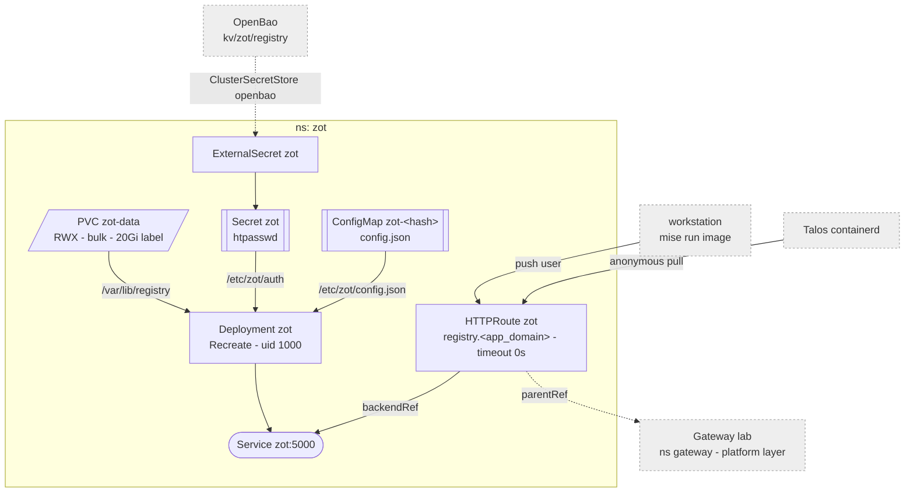

# Zot

In-cluster OCI registry for own images. Own images only -- no pull-through
cache, so the nodes need no mirror config. Config is `config.json` beside the
Deployment, through a `configMapGenerator`.

Why it looks like this:

- **Anonymous read, htpasswd `push` user for write/delete.** No
  `imagePullSecret` anywhere; nodes pull through the Gateway like any client,
  and the wildcard cert is Let's Encrypt, so containerd trusts it with no
  Talos config. The htpasswd is generated in `platform_secrets.tf` and lives
  only in OpenBao (`kv/zot/registry`).
- **`compat: docker2s2`** so a plain `docker push` (Docker-format manifests) is
  accepted, not only OCI ones.
- **Retention by push recency, not pulls:** zot cannot see what is deployed,
  and containerd never re-pulls a cached image, so a `pulledWithin` rule would
  delete the image a running app needs on its next node rebuild. Semver tags
  keep the 5 most recent, `sha-*` / `dev-*` 14 days, anything else is deleted;
  GC daily.
- **`bulk`**: an empty registry means re-pushing every own image before its app
  can restart. Dedupe hardlinks blobs, which NFS supports. The 20Gi is a
  label.
- **One replica, `Recreate`**: two instances GC-ing one directory would race.
- **`timeout 0s` on the HTTPRoute**: Envoy's 15s default cuts off large layer
  uploads.

Pushing, releasing (`mise run image`), retention table and password rotation:
[Zot](../../docs/src/platform/zot.md).
